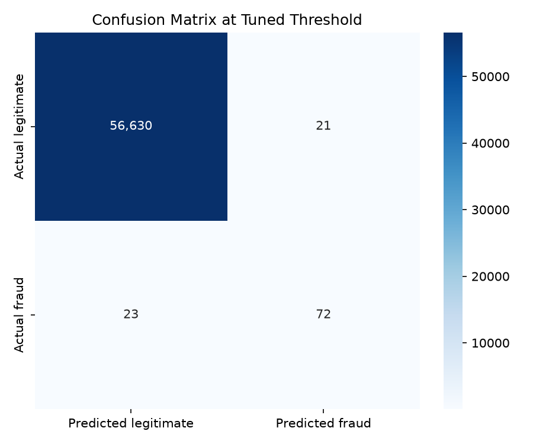
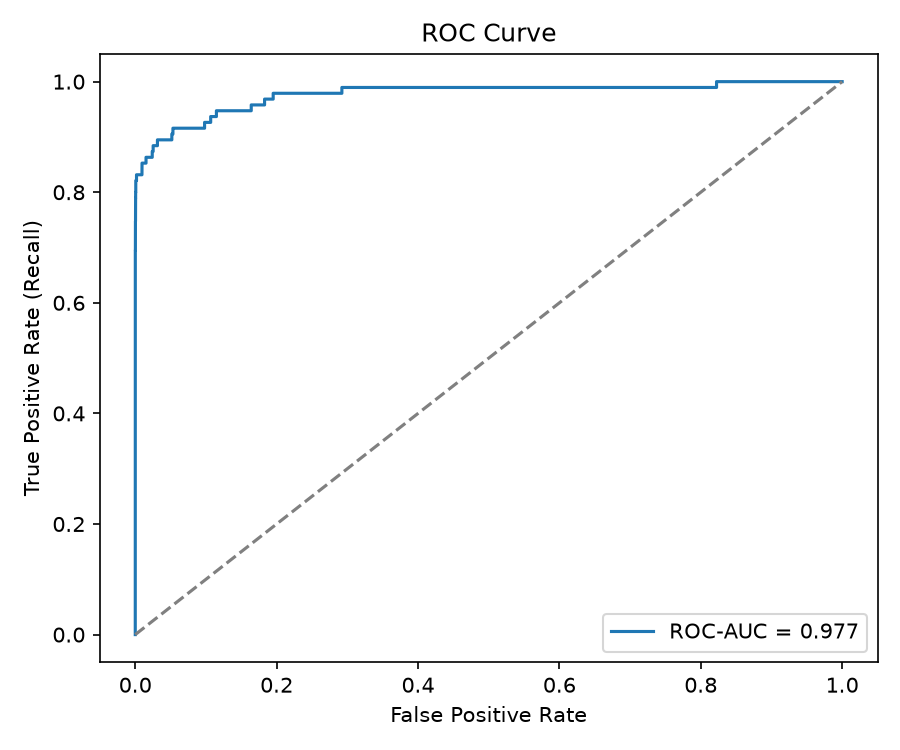
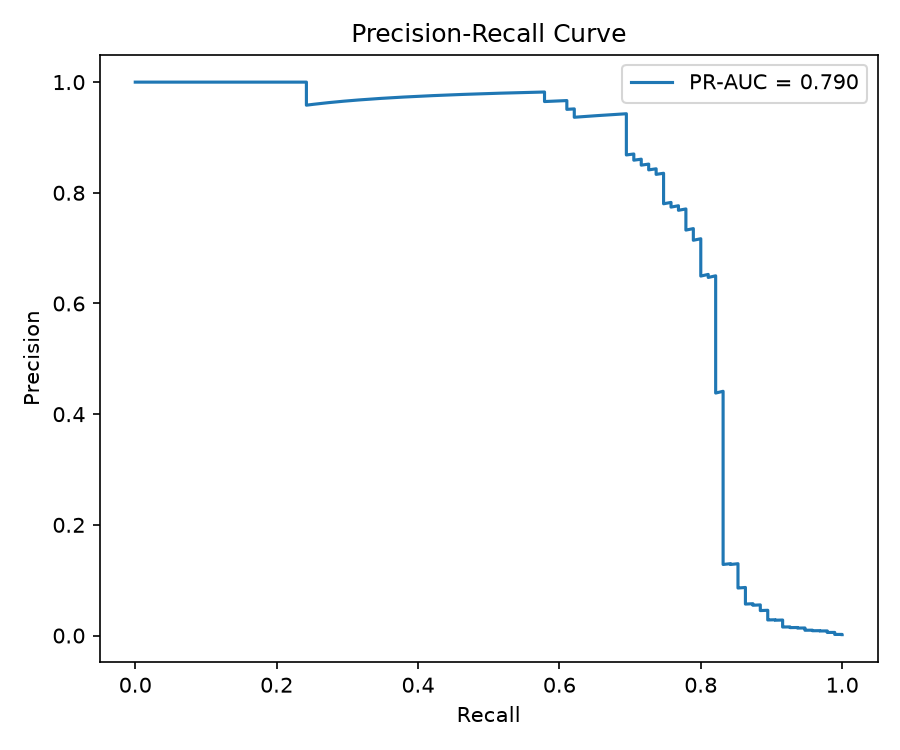
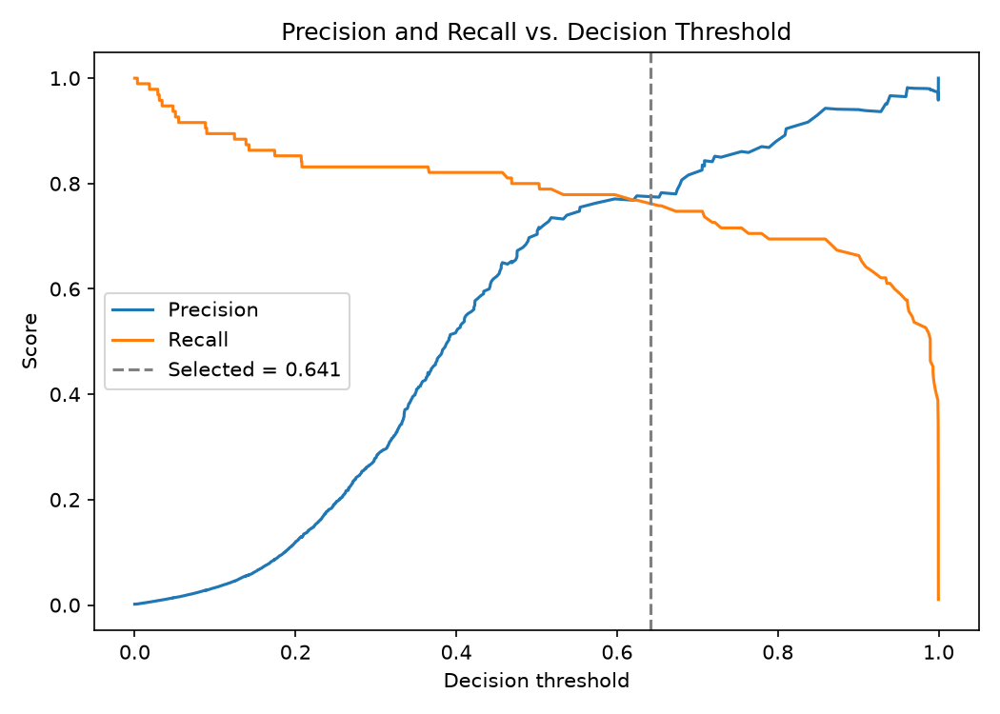

# Credit Card Fraud Detection

A machine learning model that detects fraudulent credit card transactions in a highly imbalanced dataset, with a local Streamlit demo app. Built for Month 2 of the Cyber Security internship at Arch Technologies.

> Educational project on a public, anonymised dataset. Not for real financial decisions.

## Dataset

The Credit Card Fraud Detection dataset from the ULB Machine Learning Group (with Worldline): 284,807 transactions made by European cardholders over two days, with 492 frauds (0.1727%). Features are `Time`, `Amount`, and 28 anonymised variables `V1`-`V28`.

The dataset is **not included** in this repository. Download `creditcard.csv` from [Kaggle](https://www.kaggle.com/datasets/mlg-ulb/creditcardfraud) (see the page for terms and citation) and place it at `data/creditcard.csv`.

## Approach

- Dropped 1,081 duplicate rows, then split 80/20 with stratification (random state 42) **before** any resampling to avoid data leakage.
- Scaled `Amount` and `Time` with `RobustScaler` inside the model pipeline, so scaling is fitted on training data only.
- Compared Logistic Regression and Random Forest with three imbalance strategies: class weighting, SMOTE and random undersampling.
- Selected the model with stratified 5-fold cross-validation scored by PR-AUC. The comparison ran in "fast mode" on a 50,000-row training sample that keeps all fraud rows.
- Picked the decision threshold (0.641) from out-of-fold predictions, then evaluated once on the untouched test set.

## Results

Random Forest + SMOTE, evaluated on the held-out test set (56,746 transactions, 95 frauds):

| Metric | Value |
|---|---|
| Precision | 0.774 |
| Recall | 0.758 |
| F1 | 0.766 |
| ROC-AUC | 0.977 |
| PR-AUC | 0.790 |

Confusion matrix: 72 true positives, 21 false positives, 23 false negatives, 56,630 true negatives.

Accuracy is not a useful metric here: always predicting "legitimate" would score 99.83%.

| Model | Strategy | Mean CV PR-AUC |
|---|---|---|
| Random Forest | SMOTE | 0.888 |
| Random Forest | class weight | 0.883 |
| Logistic Regression | SMOTE | 0.855 |
| Logistic Regression | class weight | 0.854 |
| Random Forest | undersampling | 0.851 |
| Logistic Regression | undersampling | 0.791 |

The top two are within one standard deviation of each other, so they are effectively tied.






## Run it

```powershell
py -m venv .venv
.\.venv\Scripts\Activate.ps1
pip install -r requirements.txt
python 01_explore.py        # data inspection and plots
python 02_train.py --fast   # compare models, fit and save the best (models/ is created locally)
python 03_evaluate.py       # evaluate on the held-out test set
python predict_demo.py      # 10-transaction console demo
python -m streamlit run app.py --server.address localhost
```

The trained model is not stored in the repository; `02_train.py` rebuilds it. Developed and tested with Python 3.14.2.

## Demo app

`app.py` is a local Streamlit app (localhost only). It checks transactions from the held-out test split, shows test-set metrics with a threshold slider, and scores uploaded CSVs in memory.

## Limitations

- Cross-validation used a sampled subset with a higher share of fraud than the real data, so CV scores look better than the final test scores. The test results above are the reported performance.
- Single train/test split; the test set holds only 95 frauds, so metrics are noisy.
- Only two model families were compared.
- Data are from two days in 2013, so results may not carry over to current data.


